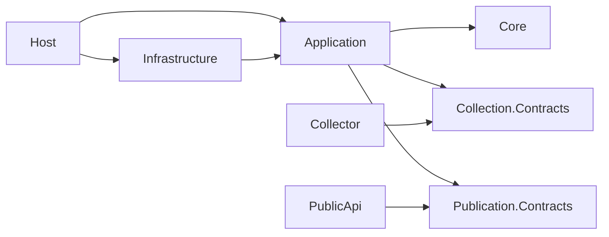

# Architecture

This page is the system overview. Start at the [lookup table](#lookup-table), then read only the feature docs you need. Each feature doc in `docs/architecture/` uses one template: Purpose, Decisions, Invariants, Behavior, Storage and contracts, Code map, and Limits and planned work.

## Product scope

Civic Lens publishes reviewed, evidence-backed records for regular citizens who want political transparency in the United States. Coverage starts at the national level. State and local coverage are possible future extensions, not initial scope.

Three views share one evidence base: officials' statements and actions, tracked-document changes, and weekly media briefs. The registry size is not fixed in code. A new official on an existing source type needs configuration only. A new source format can need a connector.

The system has one repository and three runtime parts. A C# application runs collection, analysis, and the shared private review workspace. A separate C# collector executable fetches sources. A static public publication serves approved releases.

### Record terms

- A **statement** is a public communication by an official in their own words. It comes from the official, their office, or the official record of their remarks. It states a position, makes a claim, or claims credit. One statement covers one source document, such as a press release or a floor speech. It holds the speaker, the date, a short account, and exact cited quotations.
- An **action** is an act that an official performs in their official capacity. The institution where it happened records it. Examples are sponsoring or cosponsoring a bill, withdrawing a cosponsorship, and casting a roll-call vote. Each action states whether it is a proposal, a procedural act, or a decision. What happens to a bill later is context, because it is an act of Congress, not of the official.
- A **relationship** is a reviewed link of a named type between a statement and an action or a vote. Examples are "describes own bill", "states position on", and "claims credit for". Chronology alone never creates one. The worker drafts relationships. A person reviews them. An approved relationship publishes in a static release.

### Editorial rules

- Use plain language. Distinguish statements, proposals, and completed actions.
- An introduced bill is not an enacted law. Chronology alone does not establish causation or a relationship.
- Keep event and publication dates separate from observation dates. Keep the uncertainty about exact edit times.
- Each brief states its selection period and cutoff.
- Coverage is selective. A missing record does not show inactivity. Relevant source failures stay visible as coverage limits.
- A capture is not a document version, an approval, or a publication.
- A model prediction is never a human approval. Approval binds to the exact revision and evidence reviewed.
- Code approves action records and House vote records, because their facts come from Congress.gov and the Clerk XML and code checks every citation. People approve all other records. Public pages label the headline and the summary as an AI summary of the official record. Text that a person wrote gets no label.
- Approval and publication are separate actions. Public serving reads published releases only.

### Status

Implemented:

- configured collection with durable jobs, discovery, and admission
- the Congress.gov bill stream with its relevance gate and action candidates
- the Congress.gov House vote stream with its vote candidates
- text extraction, history, and comparison
- AI drafting of document-change accounts
- the statement gate and statement drafting
- AI drafting of bill action records
- AI drafting of House vote records, one for each roll call, from the vote candidates
- action review, with person edits and withdrawals on records that code approved, and a triage page for statements
- vote review: person edits, version-bound decisions, and the tracked member votes beside their citations
- brief review: person edits, version-bound decisions, and a derived flag for changed cited records
- AI drafting of relationships between approved statements and approved actions or votes
- relationship review: person edits, version-bound decisions, and a derived flag for changed cited records
- AI drafting of weekly briefs from the records published in a closed week
- the authenticated review workspace
- static release publication of document changes, statements, actions, votes, weekly briefs, and relationships
- related records on the statement, action, and vote pages
- the public search service with its own Postgres database, fed from published releases, and the search page of each release

Pending: live Auth0 tenant verification, production deployment, AI classification, correction and withdrawal releases, and MCP. The [roadmap](roadmap.md) holds the order.

## Layers and dependency rules

Core holds domain invariants. Application holds use cases and the interfaces of external boundaries. Infrastructure implements external adapters. Host wires the application. Collection.Contracts and Publication.Contracts have no dependencies. The collector references Collection.Contracts only. The search service, `CivicLens.PublicApi`, references Publication.Contracts only. Public MCP will read the publication contract, never local application internals. Architecture tests enforce these references.

| Layer | Owns | Must not own |
|---|---|---|
| Collection.Contracts | Wire types, supported versions, request scope, receipt shape and resource accounting | Filesystem reads, scheduling, database or editorial rules |
| Core | Domain identity, evidence and review invariants | JSON process DTOs, HTTP, EF Core or local paths |
| Application | Use cases, configuration policy, external ports and mapping into domain evidence | Process launching, SQL or storage compression |
| Infrastructure | Process lifecycle, protocol decoding, actual capture verification, Postgres persistence | Independent definitions of contract or editorial validity |
| Collector | Bounded source interaction and complete raw capture production | Durable scheduling, imports, officials registry or publication |
| Host | Command parsing, composition, and web presentation | Collection algorithms or evidence invariants |
| PublicApi | Release ingest, the search index, and the public read API | Operational storage, credentials, job handlers, or unpublished evidence |

`tools/render-architecture.py` generates the diagrams below. Run `python3 tools/render-architecture.py`, then open `artifacts/architecture.html` for the explorer. Planned components are labeled there; a diagram is not a claim that the pipeline exists.

<!-- diagrams:start -->
### Collection to publication (target)

Target workflow. Implemented: configured collection with durable jobs, discovery, and admission; the Congress.gov bill stream with its gate and action candidates; text extraction, history, and comparison; AI drafting of document-change accounts; the statement gate and statement drafting; AI drafting of bill action records; AI drafting of weekly briefs; version-bound review of all record kinds, including weekly briefs and relationships; and static release publication of all record kinds. Planned: classification and private and public MCP.

```mermaid
flowchart LR
    config["Coverage configuration"]
    app["C# application"]
    collector["C# collector"]
    evidence["Evidence store"]
    analysis["Selective analysis"]
    review["Private review and MCP"]
    release["Versioned release"]
    public["Website and public MCP"]
    config --> app
    app --> collector
    collector --> evidence
    evidence --> analysis
    analysis --> review
    review --> release
    release --> public
```

### Project dependencies (implemented)

Arrows mean references. These project boundaries are checked by xUnit tests.

<!-- diagrams:end -->

## Conventions

- Build each capability from its invariants and contracts outward.
- Keep validation where its meaning is owned. Call the same validation at trust boundaries.
- Use cohesive abstractions to protect responsibilities and invariants.
- Use interfaces at external execution and persistence boundaries. Use concrete types for internal policy and transformations, unless a real variation needs another abstraction.
- Organize projects by layer and code by feature. Application and Infrastructure both use `Collection` for their parts of collection. Collector uses `Http` for its HTTP code.
- Namespaces match folders under the project namespace. Keep small contract projects flat. Keep `Program.cs` files and project-wide types at project roots.
- Do not create global `Models`, `Services`, or `Interfaces` folders.
- Keep substantive public types in their own files. Add a project only for a new dependency boundary.
- Add feature folders with implemented code only. Do not scaffold later phases.
- Tests mirror the production project suffix and feature, such as `Application/Collection`. Collection protocol tests live in `Collection/Contracts`. Dependency checks live in `Architecture`.
- Shared sample factories live in `Fixtures` when several test groups need them. One test class then does not depend on another for setup.
- Razor components in Host implement the web pages. Pages call Application handlers. Shared components display explicit data only; business rules, collection, jobs, and persistence keep their own layer.
- The solution file is the project inventory.

### Chosen stack

| Responsibility | Choice |
|---|---|
| Application and collector | .NET 10 LTS and C#; SDK pinned in `global.json` |
| Presentation | Blazor static server-side rendering with one interactive Blazor Server page; shared Razor component library and design tokens |
| Operational database | Postgres with EF Core and Npgsql; application-owned durable jobs |
| Captures | Compressed content-addressed files; immutable source and extraction versions |
| Classification (planned) | Rules from measured change history first. A model tier only if the R-13 measurement shows a need (D-05) |
| Drafting | Claude models through the official `Anthropic` C# SDK in Infrastructure; model extraction is planned; the model for each task can change after evaluation |
| Public website | C# release builder renders shared Razor components to static HTML; small JS modules add the theme toggle, the comparison control, and the search page |
| Public search and read API | `CivicLens.PublicApi`, a Web SDK project over its own Postgres database through plain Npgsql, fed from published releases |
| Local MCP (planned) | Official C# SDK; separate local development and review registration |
| Public MCP (planned) | Separate deployment over published artifacts and index; Cloudflare Worker is a candidate |
| Production hosting (planned) | Hetzner CPX21 containers and separately served static releases; Terraform and CI deployment |
| Tests and CI | xUnit, architecture, contract, and integration tests, GitHub Actions |

Package rules:

- The SDK and all packages are pinned. Add a package when its phase begins, and pin it.
- AngleSharp 1.8.3 is in Collector, for discovery, and in Infrastructure, for document text extraction. Neither parser runs scripts or requests linked resources.
- Each executable keeps its own parser adapter at its boundary. Document extraction adds no Collector reference and no parser dependency in Core or the contracts.
- `HtmlParseParityTests` runs the same hostile inputs through both parsers. A limit or element rule changed in only one copy fails a test.
- In Collector, `CaptureDecoder` owns capture decoding, and `DiscoveryCandidates` owns candidate admission. The feed and HTML parsers share both.
- EF Core Design is private tooling in Infrastructure. Other production projects must not reference database packages.
- Infrastructure pins the official `Anthropic` C# SDK 12.50.0 for the model adapters only. An architecture test checks that no other project references its assembly.
- `CivicLens.PublicApi` pins Npgsql 10.0.3 and references `Publication.Contracts` only. It has no EF Core, no Application, and no operational storage. Only Host and PublicApi use the Web SDK. An architecture test checks the references.
- No Rust, Go, Python analysis service, or React application is planned. Python's standard library serves only the development tools in `tools/`.

### Legacy reuse

Use the fixtures of the legacy crawler and its lessons about normalization, robots, pacing, redirects, retries, atomic capture, and recovery. Reimplement them in C# against the new contract. Verify registries before a selective import, and keep provenance for any migrated records. Do not port bot, propaganda, or sentiment pipelines, live dashboard aggregation, old storage schemas, duplicate registries, deployment secrets, or historical documentation.

## Shared worker mechanics

`WorkerLoop`, at the Application project root, owns three shared mechanics:

- It waits for a wakeup and reconnects after a 2-second failure backoff. `CollectionJobWorker` and `AnalysisWorker` use this.
- It renews a lease while work runs. Only `EvidenceProcessingWorker` and `AnalysisWorker` use this, because collection jobs keep `CollectionJobLeaseGuard`.
- It owns the recoverable-exception rule and the type-name error code.

A refused renewal cancels the work at once. A failed renewal is tried again while time is left before the lease deadline. The deadline counts from when the last successful renewal request was sent. Each attempt stops at that deadline.

The collection and evidence workers keep their own claim, checkpoint, and progress logic. `AnalysisWorker` owns that logic, and the budget and pause logic, for every analysis feature; see [analysis](architecture/analysis.md#behavior).

`IWorkerWakeup` is the one wakeup port. `DatabaseClock`, at the Infrastructure project root, owns the database clock expression and its read. Every store that reads database time uses it, and so does `PostgresDeadlineWakeup`. `PostgresDeadlineWakeup`, also at the project root, implements the port with a LISTEN connection and a deadline query.

Each wakeup factory gives `PostgresDeadlineWakeup` its own channel and deadline query. `PostgresCollectionPipelineWakeup` is a small factory in its feature folder. `PostgresAnalysisWakeup` is the one factory for analysis queues, and it takes the queue table name and task.

The analysis queues share the `civic_lens_analysis` channel. The notify trigger sends the payload `table:task`. Each analysis listener ignores every other payload and filters its deadline query to its own task.

## Advisory locks

`PostgresAdvisoryLock`, at the Infrastructure project root, owns every advisory lock that C# takes. It names each key and holds the one SQL statement that takes a key. Postgres hashes each text key with `hashtextextended(key, 0)` into one transaction lock. A transaction that needs several keys takes them one statement for each key, in the declared order. Every lock wait uses the default command timeout of the context, the import lock included.

The keys, in their declared order:

- `civic-lens-collection-jobs`: `PostgresCollectionJobStore` takes it at the start of each admission, claim, and settlement transaction. Discovery admission needs no other key, because this key already serializes every admission.
- Review keys: `civic-lens-document-change-review`, `civic-lens-statement-review`, `civic-lens-action-review`, `civic-lens-vote-review`, `civic-lens-relationship-review`, and `civic-lens-brief-review`. Publication takes all six of them in the order of `PostgresAdvisoryLock.ReviewKeysInOrder`. The vote key comes after the action key and before the relationship key. Vote drafting, vote review, and vote publication take it.
- The relationship key comes after the vote key and before the brief key. Relationship drafting, relationship review, and publication take it. Publication takes it with the record keys, so the record keys come first, then the relationship key, then the brief key.
- `civic-lens-collection-import`: the import store takes it for each write. No transaction holds it with another key.
- The search service has its own database and its own keys, in `SearchLocks`: `civic-lens-search-schema`, `civic-lens-search-ingest`, and `civic-lens-search-reports`. The report insert takes the reports key and holds it to the commit, so the identity sequence commits in order. No transaction holds two search keys. See [search](architecture/search.md#behavior).

A transaction that takes a brief queue row lock takes it before `civic-lens-brief-review`. The worker settlement locks its row and then takes the brief key. A publication commit, a release activation, and a review decision that must requeue a brief therefore lock every brief queue row in key order first. They use `BriefStaleness.TakeLocksAsync` and then take the brief key. A decision on a statement, an action, or a vote has saved its decision row and draft status by then. The relationship hook runs first and needs the new state. The commit and the activation take the earlier review keys, which include the relationship key (`PostgresAdvisoryLock.ReviewKeysBeforeBriefs`), then the brief rows, then the brief key.

Extraction and comparison saves take no advisory lock. Each uses `INSERT ... ON CONFLICT DO NOTHING` in one ReadCommitted transaction. See [documents](architecture/documents.md#invariants).

No transaction holds a review key with a collection key.

The search service has its own database and its own two locks, owned by `SearchLocks` in `CivicLens.PublicApi`. The service does not reference Infrastructure and the databases are separate, so these locks cannot join the order above. Postgres hashes each text key with `hashtextextended(key, 0)`.

- `civic-lens-search-schema`: `SchemaMigrator` takes it as a session lock. The migrator runs several statements and one transaction for each file. A transaction lock would end at the first commit. The session lock covers the whole run, and the migrator releases it at the end.
- `civic-lens-search-ingest`: `IndexTransaction` takes it as a transaction lock at the start of each ingest. It keeps a second service from writing a release at the same time.

No transaction holds both search keys.

An analysis settlement can add a draft row or append a revision. It then takes its queue row lock (`FOR UPDATE` in `PostgresAnalysisQueue`) before the review key of its record kind. Review and publication writes take review keys only and never lock queue rows, so no lock cycle exists. An action or vote settlement that code approves then runs the same hooks as a person decision. It locks the relationship queue rows, takes the relationship key, locks the brief queue rows, and takes the brief key, in that order.

A review decision on a statement, an action, or a vote finds the relationship pairs of its record. It saves the decision first. It holds the key of its own record kind, and a record that is not approved ends the hook. Otherwise it locks only the relationship queue rows of its record in pair key order. Then it takes the relationship key. The brief hook comes last, with the brief rows and the brief key. For these three stores, the decision and draft writes happen before the brief locks. `AfterDecisionHooks.InOrder` keeps this order. A settlement that appends a relationship revision locks its own row and then takes the relationship key.

The requeue of stale briefs takes the brief key last. A review decision takes the key of its own record kind first. The requeue changes only the queue rows of finished weeks, which no worker holds.

## Invariants

These rules cross features. Each line gives the rule, what enforces it, and the test that protects it. Feature invariants are in each feature doc.

- A capture never changes after import. Enforced by the primary key of `collection_captures` and the insert-only `PostgresCollectionAttemptStore`. Test: `PostgresCollectionAttemptStoreTests.SerializesConcurrentSameAndDistinctAttemptsAndRejectsHashLengthConflict`.
- A model prediction is never a human approval. Enforced by `ReviewPolicy`, which refuses decisions by the analysis author. Test: `ReviewPolicyTests.TheAiDrafterCannotRecordAnyDecisionEvenOnItsOwnDraft`.
- Only the worker path approves by code, and only for actions and House votes. The reserved subject `civic-lens:code` is the actor. A person cannot act as it. It publishes only actions and votes, through the `factPublishing` worker stage. Enforced by `ReviewAuthor.IsReserved`, `ReviewAuthorization`, `ReviewWriteRules`, `ReviewRecords.AppendCodeApprovedAsync`, and `PublishRelease`. Tests: `PostgresBillStreamTests.APersonCannotActAsTheCodeSubject`, `PostgresStatementDraftStoreTests.AStatementAiRevisionIsNeverApprovedByCodeBecauseOnlyAPersonApprovesJudgment`, and `PublishCodeApprovedFactsTests.TheCodeSubjectCannotPublishAJudgmentRecordBecauseOnlyAPersonApprovesJudgment`.
- A release holds the exact approved revision. Enforced by `PublishedRecordRules` and `PostgresPublicationStore`, which recheck the review state at commit. Test: `PostgresPublicationStoreTests.ASaveAfterTheBuildBlocksTheCommitBecauseTheServedRevisionWouldBeStale`.
- The collector depends on Collection.Contracts only. Enforced by the dependency map in `ArchitectureTests`. Test: `ArchitectureTests.ProductionProjectsHaveOnlyApprovedDependencies`.
- Only the current lease holder moves queue work. Each claim issues a new token and a higher fence, and a stale write fails. Enforced by `PostgresCollectionJobStore`, `EvidenceProcessingLifecycle`, and `AnalysisLifecycle`. Test: `PostgresDocumentChangeAnalysisStoreTests.AnExpiredLeaseIsRecoveredAsAnInterruptedRunAndTheStaleOwnerIsFenced`.

## Data flow

One document change moves from a source check to a published release. Each step names the table it writes and the doc that owns it.

1. The worker admits a due source check as a job: `collection_jobs` ([collection](architecture/collection.md#managed-collection-jobs)).
2. The job starts an attempt, and the collector returns a receipt and a capture: `collection_job_attempts`.
3. The import stores the observation and the capture: `collection_attempts` and `collection_captures` ([collection](architecture/collection.md#collection-domain-and-import-rules)).
4. Settlement queues evidence processing: `evidence_processing` ([collection](architecture/collection.md#preparation)).
5. Preparation of a feed or listing admits article jobs: `collection_discoveries`, `collection_admission_batches`, and `collection_candidate_jobs` ([collection](architecture/collection.md#discovery-and-admission)).
6. Extraction stores the text: `document_extractions` ([documents](architecture/documents.md#extraction)).
7. Comparison stores the diff and queues AI drafting: `document_comparisons` and `document_change_analysis` ([documents](architecture/documents.md#history)).
8. The analysis worker records a run and a draft revision: `document_change_analysis_runs`, `document_change_drafts`, and `document_change_revisions` ([analysis](architecture/analysis.md#behavior)).
9. A reviewer records a decision: `document_change_review_decisions` ([review](architecture/review.md#review-decisions)).
10. The owner publishes a release, or the `factPublishing` stage publishes code-approved actions and votes: `publication_releases` and the release files ([publication](architecture/publication.md#publish)).

Statements branch at step 6: an admitted article becomes a candidate in `statement_candidates` ([statements](architecture/statements.md)). Bills branch at step 4: a passed bill becomes a candidate in `action_candidates` ([bills](architecture/bills.md)).

## Behavior versions

Each version below has one owner. This table only points to the owners. No shared version file exists, because layers must not depend on one. Bump a version when its behavior changes in a way that old stored data would no longer match. Keep the old behavior readable. A bump-guard test next to each owner pins sample output and the current value. It fails with the name of the constant to bump. The collection protocol and the collection configuration have no bump guard.

Before the first production deploy ([R-23](roadmap.md#later)), reset the development database. Collapse the protocol, configuration, schema, parser, and behavior versions to one baseline version 1. Squash the EF migrations into one initial migration, and delete all older readers. Merge the parser and normalization versions of an extraction into one version. Name each rule set by its behavior, for example `html-text-v1` in place of `capture-text-v2`. After the first deploy, versions only grow.

| Version | Current value | Owner | Binds | Bump when |
| --- | --- | --- | --- | --- |
| Collection protocol | `10` (`Version`; reads `OldestReadableVersion` 7 and `ApiVersion` 9) | `src/CivicLens.Collection.Contracts/CollectionProtocol.cs` | Collector requests, receipts, saved handoffs, job definitions | Collector fetch, parse, or receipt rules change |
| Receipt handoff | `1` | `src/CivicLens.Application/Collection/PendingCollectionHandoff.cs` | Spool files of unimported receipts | The envelope shape changes |
| Publication schema | `5` (reads `5`) | `src/CivicLens.Publication.Contracts/PublicationProtocol.cs` | Release manifests and record JSON | The published JSON shape changes |
| Collection configuration | `2` | `src/CivicLens.Application/Collection/CollectionConfiguration.cs` | Configuration files and stored revision snapshots | Coverage or source fields change meaning |
| Issue configuration | `1` | `src/CivicLens.Application/Issues/IssueConfiguration.cs` (revisions in `IssueConfigurationRevision.cs`) | `config/issues.json` and revision IDs | The snapshot format changes |
| Parser | `capture-text-v2` | `src/CivicLens.Infrastructure/Documents/CaptureDocumentTextExtractor.cs` | Extraction IDs, text, and citations | HTML or text decoding output changes |
| Normalization | `body-text-v1` | same file | Extraction IDs, text, and citations | Whitespace or block-separator rules change |
| Comparison algorithm | `line-lcs-context-v1` | `src/CivicLens.Core/Documents/DocumentComparison.cs` | Stored comparison IDs and hunks | Hunk or word-edit output changes |
| Comparison settings | `bounded-lines-2000-...-v1` | same file | Limits recorded with each comparison | Any limit constant changes |
| Draft task | `document-change-draft-v1` | `src/CivicLens.Application/Analysis/DocumentChangeDraftTask.cs` | Analysis runs | Task flow or output handling changes |
| Draft prompt | `document-change-draft-prompt-v3` | same file | Analysis runs | Prompt text or input framing changes |
| Draft schema | `document-change-draft-schema-v2` | same file | Analysis runs | The model output schema changes |
| Statement draft task | `statement-draft-v1` | `src/CivicLens.Application/Statements/StatementDraftTask.cs` | Statement analysis runs | Task flow or output handling changes |
| Statement draft prompt | `statement-draft-prompt-v1` | same file | Statement analysis runs | Prompt text or input framing changes, for either speaker shape |
| Statement draft schema | `statement-draft-schema-v1` | same file | Statement analysis runs | The model output schema changes, for either speaker shape |
| Action draft task | `action-draft-v2` | `src/CivicLens.Application/Actions/ActionDraftTask.cs` | Action analysis runs | Task flow or output handling changes |
| Action draft prompt | `action-draft-prompt-v3` | same file | Action analysis runs | Prompt text or input framing changes |
| Action draft schema | `action-draft-schema-v1` | same file | Action analysis runs | The model output schema changes |
| Vote draft task | `vote-draft-v3` | `src/CivicLens.Application/Votes/VoteDraftTask.cs` | Vote analysis runs | Task flow or output handling changes |
| Vote draft prompt | `vote-draft-prompt-v2` | same file | Vote analysis runs | Prompt text or input framing changes |
| Vote draft schema | `vote-draft-schema-v1` | same file | Vote analysis runs | The model output schema changes |
| Vote fingerprint | `vote-fingerprint-v1` | `src/CivicLens.Application/Votes/VoteFingerprint.cs` | The run input hash of a draft that makes no call | The canonical text of the fingerprint changes |
| House vote render | `house-vote-render-v2` | `src/CivicLens.Application/Collection/HouseVotes/HouseVoteRenderer.cs` | Vote extraction text and citations | The rendered text of a vote changes |
| Sponsorship fingerprint | `action-fingerprint-v1` | `src/CivicLens.Application/Collection/Bills/ActionFingerprint.cs` | The fingerprint in each action revision | The canonical text of an entry changes |
| Relationship draft task | `relationship-draft-v1` | `src/CivicLens.Application/Relationships/RelationshipDraftTask.cs` | Relationship analysis runs | Task flow or output handling changes |
| Relationship draft prompt | `relationship-draft-prompt-v1` | same file | Relationship analysis runs | Prompt text or input framing changes |
| Relationship draft schema | `relationship-draft-schema-v1` | same file | Relationship analysis runs | The model output schema changes |
| Relationship fingerprint | `relationship-fingerprint-v1` | `src/CivicLens.Application/Relationships/RelationshipFingerprint.cs` | The last settled input of a pair | The canonical text of the fingerprint changes |
| Relationship pair key | `relationship-v1` | `src/CivicLens.Application/Relationships/RelationshipPair.cs` | The queue key and record ID of a relationship | The canonical text of the key changes |
| Brief draft task | `brief-draft-v1` | `src/CivicLens.Application/Briefs/BriefDraftTask.cs` | Brief analysis runs | Task flow or output handling changes |
| Brief draft prompt | `brief-draft-prompt-v1` | same file | Brief analysis runs | Prompt text or input framing changes |
| Brief draft schema | `brief-draft-schema-v1` | same file | Brief analysis runs | The model output schema changes |
| Brief fingerprint | `brief-fingerprint-v1` | `src/CivicLens.Application/Briefs/BriefFingerprint.cs` | The fingerprint in each brief revision | The canonical text of the fingerprint changes |
| Gate task | `statement-gate-v2` | `src/CivicLens.Application/Statements/StatementGateTask.cs` | Statement analysis runs | Task flow or output handling changes |
| Gate prompt | `statement-gate-prompt-v2` | same file | Statement analysis runs | Prompt text or input framing changes |
| Gate schema | `statement-gate-schema-v2` | same file | Statement analysis runs | The model output schema changes |

## Glossary

- **Job**: one durable collection task for one source and URL, in `collection_jobs`.
- **Attempt**: one collector run of a job. A retry makes a new attempt with a new ID.
- **Receipt**: the verified result that the collector returns for an attempt.
- **Handoff**: a saved receipt on disk, kept until its import is confirmed.
- **Capture**: the raw bytes of a response, stored once by SHA-256.
- **Observation**: the stored record of an attempt, with its outcome and response metadata.
- **Pacing key**: the origin or pacing group that limits how often jobs reach one host.
- **Extraction**: the normalized text of one capture under one parser, normalization, and profile.
- **Comparison**: the stored diff of two compatible extractions of one source and URL.
- **Candidate**: one item that analysis may draft: an article, a bill version, or a changed comparison.
- **Gate**: a step that decides whether a candidate goes on to drafting.
- **Run**: one model call or bypass, stored insert-only with its versions and tokens.
- **Lease**: a time-limited claim on a queue entry, held by one token.
- **Fence**: a number that each claim increases, so a stale owner cannot write.
- **Checkpoint**: a fenced write that records the progress or the outcome of claimed work.
- **Settlement**: the final write of an attempt or a run, with its accounting.
- **Reservation**: the tokens or allowance held before a call and settled after it.
- **Draft**: the review record of one candidate, with its current revision and status.
- **Revision**: one immutable saved version of a draft.
- **Decision**: one immutable review action bound to one revision.
- **Review state version**: a counter that each revision and decision increases.
- **Release**: one numbered, immutable set of published records.

## Lookup table

This is the only navigation index.

| Concept or question | Doc section | Code entry |
|---|---|---|
| Product scope, record terms, editorial rules | [Product scope](#product-scope) | none |
| Layer ownership and project references | [Layers and dependency rules](#layers-and-dependency-rules) | `tests/CivicLens.Tests/Architecture/ArchitectureTests.cs` |
| Packages and stack | [Chosen stack](#chosen-stack) | `global.json`, `Directory.Build.props` |
| People, sources, coverage, dated names | [Configuration](architecture/configuration.md#people-and-sources) | `src/CivicLens.Application/Collection/CollectionConfiguration.cs` |
| Configuration revisions and replay of admissions | [Configuration](architecture/configuration.md#revisions) | `src/CivicLens.Application/Collection/CollectionConfigurationRevision.cs` |
| Tracked issues and policy areas | [Configuration](architecture/configuration.md#tracked-issues) | `src/CivicLens.Application/Issues/IssueConfiguration.cs` |
| Version constants and when to bump them | [Behavior versions](#behavior-versions) | see table |
| Worker wakeups, leases, database clock | [Shared worker mechanics](#shared-worker-mechanics) | `src/CivicLens.Application/WorkerLoop.cs` |
| Advisory lock keys and lock order | [Advisory locks](#advisory-locks) | `src/CivicLens.Infrastructure/PostgresAdvisoryLock.cs` |
| Cross-feature invariants | [Invariants](#invariants) | none |
| Path from a source check to a release | [Data flow](#data-flow) | none |
| Shared terms | [Glossary](#glossary) | none |
| Collection boundary and design rules | [Collection](architecture/collection.md#decisions) | `src/CivicLens.Collection.Contracts/CollectionProtocol.cs` |
| Collector protocol, receipts, API mode, credentials | [Collection](architecture/collection.md#collector-protocol) | `src/CivicLens.Collection.Contracts/CollectionRequest.cs` |
| Robots rules, robots cache, crawl delay, pacing groups | [Collection](architecture/collection.md#robots-and-pacing) | `src/CivicLens.Collector/Http/RobotsRules.cs` |
| Feed and HTML discovery, article admission | [Collection](architecture/collection.md#discovery-and-admission) | `src/CivicLens.Application/Collection/Discovery/DiscoveryAdmissionPolicy.cs` |
| Collection attempts, import rules, 304 links | [Collection](architecture/collection.md#collection-domain-and-import-rules) | `src/CivicLens.Core/Collection/CollectionImportPolicy.cs` |
| Receipt spool and replay | [Collection](architecture/collection.md#receipt-handoff-and-replay) | `src/CivicLens.Application/Collection/PendingCollectionHandoff.cs` |
| Managed jobs, budgets, retries, recovery | [Collection](architecture/collection.md#managed-collection-jobs) | `src/CivicLens.Application/Collection/Jobs/RunCollectionJob.cs` |
| Worker pipeline, schedules, configuration revision rows | [Collection](architecture/collection.md#autonomous-collection-engine) | `src/CivicLens.Application/Collection/Jobs/CollectionJobWorker.cs` |
| Preparation, extraction and comparison stages | [Collection](architecture/collection.md#preparation) | `src/CivicLens.Application/Collection/Processing/JobPreparation.cs` |
| Sources page | [Collection](architecture/collection.md#sources-page) | `src/CivicLens.Host/Collection/SourcesPage.razor` |
| CLI collect and import commands | [Collection](architecture/collection.md#cli-composition) | `src/CivicLens.Host/Program.cs` |
| Member and executive rosters, dated terms, proposals | [Roster](architecture/roster.md#behavior) | `src/CivicLens.Application/Roster/MemberRosterParser.cs` |
| Generated schema: tables, keys, checks, indexes, triggers | [collection](architecture/schema/collection.md), [bills](architecture/schema/bills.md), [votes](architecture/schema/votes.md), [roster](architecture/schema/roster.md), [documents](architecture/schema/documents.md), [analysis](architecture/schema/analysis.md), [statements](architecture/schema/statements.md), [actions](architecture/schema/actions.md), [briefs](architecture/schema/briefs.md), [relationships](architecture/schema/relationships.md), [review](architecture/schema/review.md), [reports](architecture/schema/reports.md), [publication](architecture/schema/publication.md) | `tests/CivicLens.Tests/Infrastructure/SchemaReferenceTests.cs` |
| Collection tables and the import lock | [Collection](architecture/collection.md#storage-and-contracts) | `src/CivicLens.Infrastructure/Collection/PostgresCollectionAttemptStore.cs` |
| Congress.gov bill list, window, cursor | [Bills](architecture/bills.md#daily-window) | `src/CivicLens.Application/Collection/Bills/BillStreamWindow.cs` |
| Bill gate and follow-on pages | [Bills](architecture/bills.md#bill-gate) | `src/CivicLens.Application/Collection/Bills/BillGate.cs` |
| Bill page extraction text | [Bills](architecture/bills.md#extraction) | `src/CivicLens.Application/Collection/Bills/CongressBillRenderer.cs` |
| Action candidates | [Bills](architecture/bills.md#action-candidate) | `src/CivicLens.Infrastructure/Collection/Jobs/PostgresCollectionJobStore.ActionCandidates.cs` |
| Congress.gov House vote sweep, sessions, URLs | [Votes](architecture/votes.md#daily-sweep) | `src/CivicLens.Application/Collection/HouseVotes/HouseVoteSession.cs` |
| House vote parsers and admission | [Votes](architecture/votes.md#parsing) | `src/CivicLens.Application/Collection/HouseVotes/HouseVoteParser.cs` |
| Vote candidates | [Votes](architecture/votes.md#admission) | `src/CivicLens.Infrastructure/Collection/Jobs/PostgresCollectionJobStore.HouseVotes.cs` |
| Vote tables: versions and candidates | [Votes](architecture/votes.md#storage-and-contracts) | `src/CivicLens.Infrastructure/Collection/HouseVotes/` |
| Vote drafting, facts, and the member-vote copy | [Votes](architecture/votes.md#drafting) | `src/CivicLens.Application/Votes/VoteDraftStep.cs` |
| Vote commands | [Votes](architecture/votes.md#owner-commands) | `src/CivicLens.Host/Votes/VoteCommand.cs` |
| Vote kind table | [Votes](architecture/votes.md#decisions) | `src/CivicLens.Application/Votes/VoteKindTable.cs` |
| Vote queue outcomes and codes | [Votes](architecture/votes.md#outcomes) | `src/CivicLens.Application/Votes/VoteDraftErrorCodes.cs` |
| Vote drafting tables: queue, runs, budget, drafts, revisions, decisions | [Votes](architecture/votes.md#storage-and-contracts) | `src/CivicLens.Infrastructure/Votes/` |
| Vote revisions and the person edit rule | [Votes](architecture/votes.md#record-and-append) | `src/CivicLens.Core/Votes/VoteDraftRevision.cs` |
| Vote review pages and the cast display | [Votes](architecture/votes.md#vote-review) | `src/CivicLens.Host/Review/VoteEditor.razor` |
| Action drafting | [Actions](architecture/actions.md#step) | `src/CivicLens.Application/Actions/ActionDraftStep.cs` |
| Action revisions and the person edit rule | [Actions](architecture/actions.md#revision-and-append) | `src/CivicLens.Core/Actions/ActionDraftRevision.cs` |
| Action review pages | [Actions](architecture/actions.md#action-review) | `src/CivicLens.Host/Review/ActionEditor.razor` |
| Action commands | [Actions](architecture/actions.md#commands) | `src/CivicLens.Host/Actions/ActionCommand.cs` |
| Action queue outcomes and codes | [Actions](architecture/actions.md#outcomes) | `src/CivicLens.Application/Actions/ActionDraftErrorCodes.cs` |
| Bill stream tables: cursors, gates, pages, candidates | [Bills](architecture/bills.md#storage-and-contracts) | `src/CivicLens.Infrastructure/Collection/BillStream/` |
| Action tables: queue, runs, budget, drafts, revisions, decisions | [Actions](architecture/actions.md#storage-and-contracts) | `src/CivicLens.Infrastructure/Actions/` |
| Relationship pairs, bill number and title matching, the pair key | [Statements](architecture/statements.md#relationship-drafting) | `src/CivicLens.Application/Relationships/RelationshipPairFinder.cs` |
| Relationship drafting, fingerprint, staleness, and outcomes | [Statements](architecture/statements.md#relationship-drafting) | `src/CivicLens.Application/Relationships/RelationshipDraftStep.cs` |
| Relationship revisions and the Congress rule | [Statements](architecture/statements.md#relationship-drafting) | `src/CivicLens.Core/Relationships/RelationshipRevision.cs` |
| Relationship review pages, person edits, approval gate, and changed-citation flag | [Statements](architecture/statements.md#relationship-review) | `src/CivicLens.Host/Review/RelationshipEditor.razor`, `src/CivicLens.Infrastructure/Relationships/PostgresRelationshipReviewStore.cs` |
| Relationship commands | [Statements](architecture/statements.md#relationship-drafting) | `src/CivicLens.Host/Relationships/RelationshipCommand.cs` |
| Relationship tables: queue, runs, budget, drafts, revisions, decisions | [Statements](architecture/statements.md#storage-and-contracts) | `src/CivicLens.Infrastructure/Relationships/` |
| Weekly brief drafting and the week rule | [Briefs](architecture/briefs.md#step) | `src/CivicLens.Application/Briefs/BriefDraftStep.cs` |
| Brief selection, grouping, and fingerprint | [Briefs](architecture/briefs.md#selection) | `src/CivicLens.Application/Briefs/BriefSelection.cs` |
| Brief revisions and citations | [Briefs](architecture/briefs.md#revision-and-append) | `src/CivicLens.Core/Briefs/BriefRevision.cs` |
| Brief weekly enqueue and the Monday wakeup | [Briefs](architecture/briefs.md#queue) | `src/CivicLens.Infrastructure/Briefs/PostgresBriefDraftStore.cs` |
| Brief review pages, person edits, approval gate, and changed-citation flag | [Briefs](architecture/briefs.md#brief-review) | `src/CivicLens.Host/Review/BriefEditor.razor`, `src/CivicLens.Infrastructure/Briefs/PostgresBriefReviewStore.cs` |
| Brief staleness after a publication, an activation, or a review decision | [Briefs](architecture/briefs.md#staleness) | `src/CivicLens.Infrastructure/Briefs/BriefStaleness.cs` |
| Brief publication: ready list, citation recheck, record, and page | [Briefs](architecture/briefs.md#publication) | `src/CivicLens.Application/Publication/BriefRecordLoader.cs` |
| Brief commands | [Briefs](architecture/briefs.md#commands) | `src/CivicLens.Host/Briefs/BriefCommand.cs` |
| Brief queue outcomes and codes | [Briefs](architecture/briefs.md#outcomes) | `src/CivicLens.Application/Briefs/BriefDraftErrorCodes.cs` |
| Brief tables: queue, runs, budget, status, drafts, revisions, citations | [Briefs](architecture/briefs.md#storage-and-contracts) | `src/CivicLens.Infrastructure/Briefs/` |
| Text extraction, profiles, citations | [Documents](architecture/documents.md#extraction) | `src/CivicLens.Application/Documents/ExtractDocument.cs` |
| Document history and comparisons | [Documents](architecture/documents.md#history) | `src/CivicLens.Core/Documents/DocumentComparison.cs` |
| Evidence pages under `/Documents` | [Documents](architecture/documents.md#evidence-pages) | `src/CivicLens.Host/Documents/ComparisonPage.razor` |
| AI queue, budgets, retries, pauses | [Analysis](architecture/analysis.md#behavior) | `src/CivicLens.Application/Analysis/AnalysisWorker.cs` |
| AI drafting of document-change accounts | [Analysis](architecture/analysis.md#prompt-and-output) | `src/CivicLens.Application/Analysis/DocumentChangeDraftStep.cs` |
| Planned classification and datasets | [Analysis](architecture/analysis.md#limits-and-planned-work) | none |
| Statement candidates and the issue gate | [Statements](architecture/statements.md#issue-gate) | `src/CivicLens.Application/Statements/StatementGateStep.cs` |
| Statement drafting | [Statements](architecture/statements.md#statement-drafting) | `src/CivicLens.Application/Statements/StatementDraftStep.cs` |
| Gate labels, held-out split, label export | [Statements](architecture/statements.md#gate-labels) | `src/CivicLens.Core/Statements/GateLabelSplit.cs` |
| Statement review pages and commands | [Statements](architecture/statements.md#statement-review) | `src/CivicLens.Host/Review/StatementEditor.razor` |
| Review decisions, roles, concurrency | [Review](architecture/review.md#review-decisions) | `src/CivicLens.Core/Review/ReviewPolicy.cs` |
| Review cycles, history caps, the shared append step | [Review](architecture/review.md#review-cycles) | `src/CivicLens.Infrastructure/Review/ReviewRecords.cs` |
| Review lists, paging, overview counts | [Review](architecture/review.md#lists-and-paging) | `src/CivicLens.Application/Review/ListDocumentChangeReviews.cs` |
| Statement triage page and inline decisions | [Review](architecture/review.md#triage) | `src/CivicLens.Host/Review/StatementTriage.razor.cs` |
| Releases, activation, rollback | [Publication](architecture/publication.md#publish) | `src/CivicLens.Application/Publication/PublishRelease.cs` |
| Release record content and schema | [Publication](architecture/publication.md#release-content) | `src/CivicLens.Publication.Contracts/PublicationRelease.cs` |
| Published vote record, builder, and page | [Publication](architecture/publication.md#vote-record) | `src/CivicLens.Publication.Contracts/PublishedVote.cs` |
| Published relationship record, builder, and page | [Publication](architecture/publication.md#relationship-record) | `src/CivicLens.Publication.Contracts/PublishedRelationship.cs` |
| Related records on record pages | [Publication](architecture/publication.md#related-records) | `src/CivicLens.Application/Publication/ReleasePages.cs` |
| Backups, retention, monitoring | [Publication](architecture/publication.md#limits-and-planned-work) | none |
| Web host, security headers, components | [Host](architecture/host.md#behavior) | `src/CivicLens.Host/Program.cs` |
| Production hosting plan | [Host](architecture/host.md#limits-and-planned-work) | none |
| MCP plans | [Review](architecture/review.md#limits-and-planned-work), [Publication](architecture/publication.md#limits-and-planned-work) | none |
| Public search service: ingest, index, read API, rate limit | [Search](architecture/search.md#decisions) | `src/CivicLens.PublicApi/PublicApiApp.cs` |
| Reader report queue: pull, resolve, banner | [Review](architecture/review.md#reader-reports), [Search](architecture/search.md#operational-pull) | `src/CivicLens.Application/Reports/PullReaderReports.cs`, `src/CivicLens.Infrastructure/Reports/PostgresReaderReportStore.cs` |
| Search ingest of a release | [Search](architecture/search.md#ingest) | `src/CivicLens.PublicApi/Ingest/ReleaseIngest.cs` |
| Search API routes and errors | [Search](architecture/search.md#api) | `src/CivicLens.PublicApi/Search/SearchEndpoints.cs` |
| Officials and catalog files of a release | [Publication](architecture/publication.md#release-content) | `src/CivicLens.Application/Publication/PublicationOfficials.cs` |
| Official pages, officials list, and vote files of an official | [Publication](architecture/publication.md#release-content) | `src/CivicLens.Application/Publication/ReleaseOfficialPages.cs` |
| Public filter pages (planned) | [Publication](architecture/publication.md#limits-and-planned-work), [roadmap R-36](roadmap.md#next) | none |
| Pending work, decisions, MVP criteria | [Roadmap](roadmap.md) | none |
| Commands and procedures | [Operations](operations.md) | `src/CivicLens.Host/Program.cs` |
